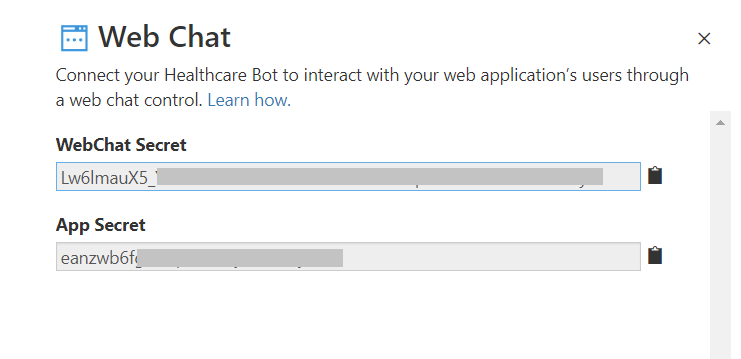
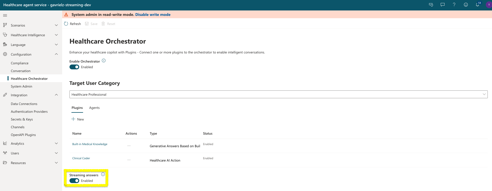

# Health Bot Container

A simple web page that allows users to communicate with the [Azure Health Bot](https://azure.microsoft.com/en-us/services/bot-services/health-bot/) through a WebChat.

**Note:** In order to use this Web Chat with the Health Bot service, you will need to obtain your Web Chat secret by going to `Integration/Secrets` on the navigation panel.



1.Deploy the website:

**Choose `linux` as the Operating System** on the deployment form. Linux is the default and the only supported option for this sample. Do not switch it to Windows.

[](https://portal.azure.com/#create/Microsoft.Template/uri/https%3A%2F%2Fraw.githubusercontent.com%2Fmicrosoft%2FHealthBotContainerSample%2Fmaster%2Fazuredeploy.json)

2.Set the following environment variables:

`AUTH_JWT_SECRET`

`WEBCHAT_SECRET`

3.Configure scenario invocation (optional):

The Health Bot service uses [language models](https://docs.microsoft.com/HealthBot/language_model_howto) to interpret end user utterances and trigger the relevant scenario logic in response.

Alternatively, you can programmaticaly invoke a scenario before the end user provides any input.

To implement this behavior, uncomment the following code from the `InitConversation` invoke in the `src/streaming/middleware/connectionMiddleware.ts` file:
```javascript
triggeredScenario: {
    trigger: "{scenario_id}",
    args: {
        myVar1: "{custom_arg_1}",
        myVar2: "{custom_arg_2}"
    }
}
```
Replace {scenario_id} with the scenario ID of the scenario you would like to invoke.
You can also pass different values through the "args" object. 

You can read more about programmatic client side scenario invocation [here](https://docs.microsoft.com/HealthBot/integrations/programmatic_invocation)


4.Set the Bot service direct line channel endpoint (optional)

In some cases it is required to set the endpoint URI so that it points to a specific geography. The geographies supported by the bot service each have a unique direct line endpoint URI:

- `directline.botframework.com` routes your client to the nearest datacenter. This is the best option if you do not know where your client is located.
- `asia.directline.botframework.com` routes only to Direct Line servers in Eastern Asia.
- `europe.directline.botframework.com` routes only to Direct Line servers in Europe.
- `northamerica.directline.botframework.com` routes only to Direct Line servers in North America.

Pass your preferred geographic endpoint URI by setting the environment variable: `DIRECTLINE_ENDPOINT_URI` in your deployment. If no variable is found it will default to `directline.botframework.com`

**Note:** If you are deploying the code sample using the "Deploy to Azure" option, you should add the above secrets to the application settings for your App Service.

## Streaming responses
This sample supports streaming bot responses, so answers appear progressively as they are generated instead of all at once. Streaming is driven by the bot — it activates automatically when the **streaming feature flag is enabled** for your Health Bot instance. When the flag is off, the sample falls back to the standard single-response behavior with no changes required.

To enable streaming, turn the feature on in the Management Portal: go to `Configuration` > `Healthcare Orchestrator` and set the **Streaming answers** toggle to `Enabled`. The toggle appears only when streaming is available for your bot. If you don't see it, contact your Health Bot administrator.



You can also request streaming for a single request, without changing the bot configuration. Add `stream: true` to the `value` of the message activity you send to the bot:
```json
{
    "type": "message",
    "from": { "id": "<userId>" },
    "text": "What is the first-line treatment for hypertension?",
    "value": { "stream": true }
}
```
When `stream` is `true`, the answer streams even if the **Streaming answers** toggle is off. Any other value (or no value) follows the toggle. This flag is part of the request payload only; it does not change how the chat UI looks.

## Agent webchat
If the agent webchat sample is also required, [switch to the live agent handoff branch](https://github.com/Microsoft/HealthBotContainerSample/tree/live_agent_handoff)
